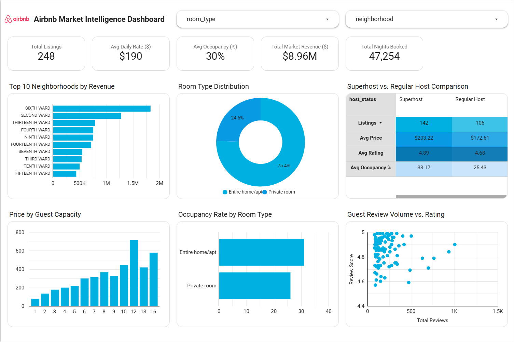

# Airbnb Market Intelligence & Analytics Pipeline (GCP, Python, BigQuery, Looker Studio)

An end-to-end cloud ELT data pipeline and interactive business intelligence dashboard analyzing 365-day forward-looking Airbnb booking dynamics, pricing elasticity, and host performance.



---

## Executive Summary & Market Insights

Analyzed **248 verified listings** across **47,254 forward booked nights**, establishing a total estimated market volume of **$8.96M** with an **Average Daily Rate (ADR) of $190** and **30% average occupancy**.

* **Superhost Economic Moat:** Superhosts command an **18% pricing premium** ($203.22 vs. $172.61 ADR) while achieving higher occupancy (**33.17% vs. 25.43%**) and guest satisfaction (4.89 vs. 4.68 rating) compared to regular hosts.
* **Geographic Revenue Clustering:** Revenue is heavily concentrated in prime districts, led by **Sixth Ward (~$1.85M)** and **Second Ward (~$1.3M)**.
* **Supply Dominance:** The market is predominantly driven by **Entire home/apt accommodations (75.4%)**, with Private rooms holding 24.6% and Shared rooms remaining negligible (<1%).
* **Capacity Unit Economics:** Nightly pricing scales predictably from $80 (1 guest) to $360 (8 guests), with substantial pricing jumps ($550–$700+) for large-group inventory (10+ guests).

---

## Technical Architecture & Pipeline

```text
[Raw Inside Airbnb Data] (Listings & 365-Day Calendar CSVs)
           │
           ▼
[Local / Cloud Python Preprocessing] (pandas, regex cleaning, encoding normalization)
           │
           ▼
[Google Cloud Storage (GCS)] (`gs://air-bnb/...`)
           │
           ▼
[Python Vertex AI Workbench] (Data profiling, duplicate audit, null audits)
           │
           ▼
[BigQuery ELT Modeling] (Standard SQL, window-function deduplication, grain aggregation)
           │
           ▼
[Looker Studio BI Layer] (Executive KPI scorecards, cohort benchmarking, distribution analytics)
